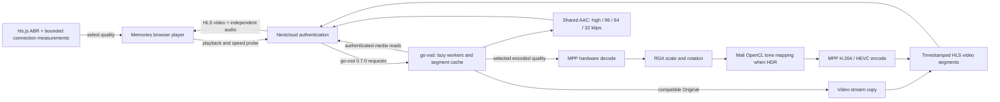

# Memories 11.1.1 on RK3588

Hardware transcoding for **Nextcloud Memories 11.1.1 / go-vod 0.7.0** on a ROCK 5B+ with the Armbian 6.1 vendor kernel, Rockchip MPP/RGA and Mali-G610 OpenCL. Hardware validation was performed with the earlier Memories 11.0.2 setup; the 11.1.1 integration requires fresh real-device validation.

The server requires hardware video processing: MPP decoding/encoding, RGA scaling/rotation and Mali HDR-to-SDR mapping. Unsupported video fails explicitly instead of silently using CPU video processing. Compatible SDR AVC/HEVC originals use stream copy. Audio is shared across video qualities; the browser keeps one default audio track during video quality changes.

This combined 11.1.1 compatibility update also includes the complete-response bandwidth-probe fix and its regression tests from PR #17. A failed/truncated probe no longer overwrites the last valid complete sample.

The browser helper uses **hls.js native ABR** for Auto quality: hls.js selects each rendition, responds to buffer starvation and adapts as transfer bandwidth changes. **Original** is named in the quality menu and participates in Auto when its source codec is compatible and the connection has enough capacity. It copies the source video packets instead of re-encoding them; compatible shared audio follows the existing audio policy. Main10 SDR HEVC requires an explicit browser MediaSource capability. Its HLS declaration identifies Main10 accurately, while encoded fallbacks remain Main. HDR retains the existing SDR tone-mapping path.

Manual choices pin a rendition; reselecting Auto restores `loadLevel = -1`. A bounded same-origin probe seeds the initial bandwidth estimator. The redundant hls.js lowest-rendition bitrate test is disabled: on-demand encoder startup makes that test misleading and used to insert a 480p segment into otherwise 4K playback. Genuine slow-transfer adaptation remains enabled. Original is temporarily capped out of Auto until its copy-grid playlist is ready. An 18-second forward buffer and 96 MiB cap provide headroom. The playback badge reports the actual presented dimensions. See [the startup and Original verification](STARTUP_ORIGINAL_FIX.md).

## Playback flow



Only requested renditions start workers. The native hls.js estimator uses regular fragment data, with connection-change and low-quality recovery probes as safeguards; hls.js itself chooses the levels. Audio has its own shared timeline and the browser does not automatically change audio profiles during video quality changes. SDR skips HDR tone mapping. Native Android (ExoPlayer) and Safari native HLS are separate clients and are not changed by this browser helper.

High audio is 192 kbps AAC when encoding, or the existing source bitrate when compatible AAC can be copied (up to 320 kbps). Lower profiles are 96, 64 and 32 kbps.

## Deploy on the ROCK 5B+

Docker/Compose and the device nodes in `compose.yml` are required. Copy `.env.example` to `.env` if the internal Nextcloud URL, Docker network or numeric device groups differ. The default Nextcloud layout is LinuxServer's `/app/www/public`, container `nextcloud`.

```sh
git switch main
git pull --ff-only
sh scripts/deploy-v11.sh
```

**First upgrade the official Memories app to 11.1.1 using Nextcloud's normal update process.** The script then checks for exactly Memories 11.1.1, builds and tests the ARM64 image, starts the health-checked service, installs the browser helper and verifies the real go-vod 0.7.0 handshake. It does not upgrade the official Memories app. Do not run it until the draft PR is reviewed and merged. The container has a read-only root, no capabilities, no published host port and a dedicated cache volume. Original media is fetched through authenticated Nextcloud callbacks.

## Validate

```sh
npm ci --ignore-scripts
npm test
php scripts/test-v11-compat.php
bash scripts/test-v11-rkmpp.sh --matrix
```

The board matrix tests all ten supported input codecs against both hardware encoders, PQ/HLG, RGA, packet cadence, full/cold timelines, shared audio, serving and API behavior. See [hardware tests](HARDWARE_TEST_V11.md), [playback evidence](PLAYBACK_ACCEPTANCE_V11.md) and [player integration](PLAYER_INTEGRATION_V11.md).

`go-vod/` is the only engine source, `memories_rkmpp_v11/` is the browser helper and `scripts/` contains deployment and the two reproducible board/network runners. The obsolete 10.2 engine/helper, duplicate upstream tree and old deployment tooling were removed; their source remains in Git history.

The native Android companion is developed separately on `import/laptop-2026-11-04` and is excluded from this release. Its reported startup failure remains open. Browser results do not establish native Android, Safari, public-share or perceptual HDR/audio acceptance. See [current status](PROGRESS_MEMORIES_11.md).
